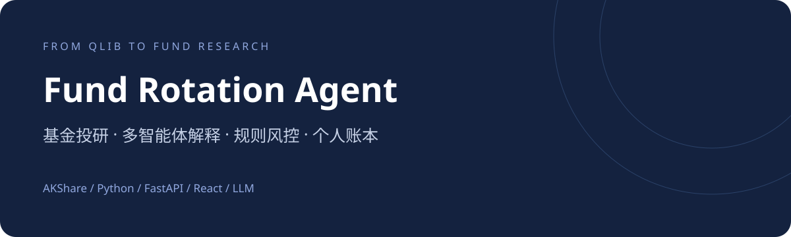
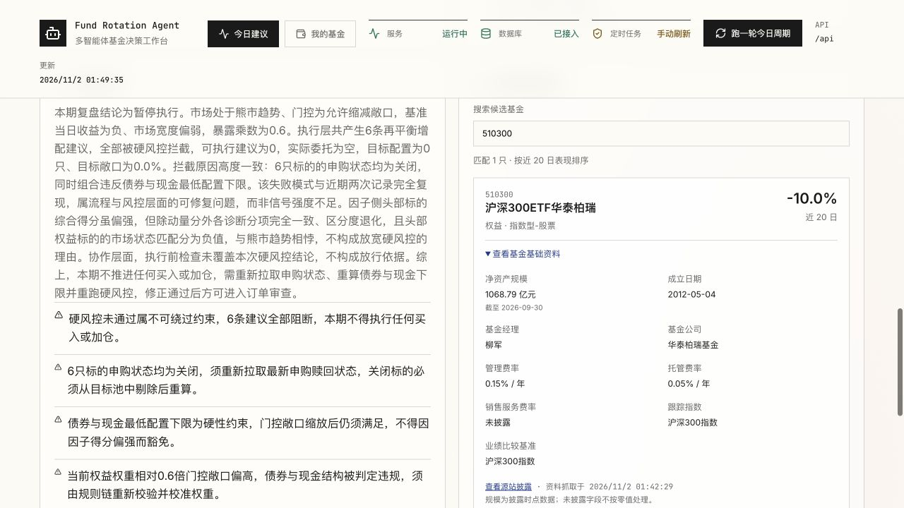
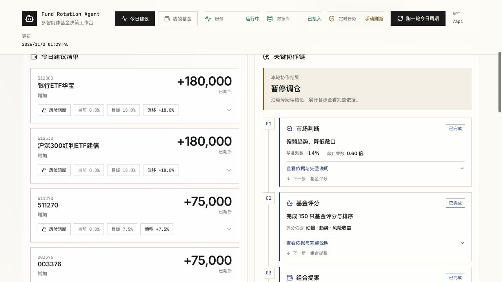
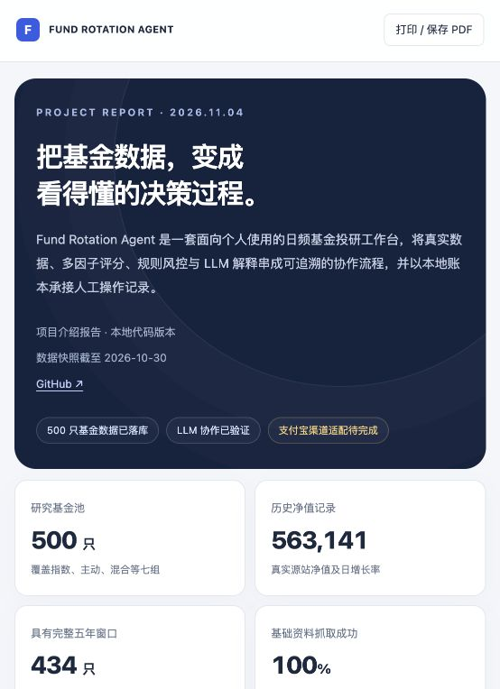
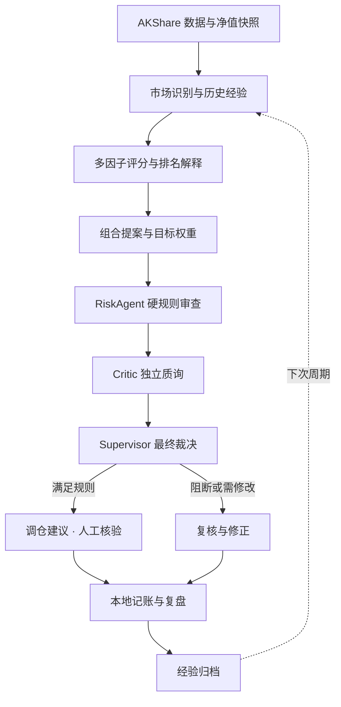
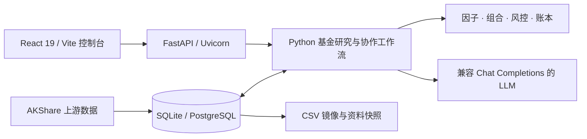

<div align="center">



# Fund Rotation Agent

**从 Qlib 股票量化方案改造而来的个人基金投研与多智能体协作工作台**


[项目介绍](#项目介绍) · [页面预览](#页面预览) · [快速启动](#快速启动) · [完整指南](services/ashare-qlib-agent/README.md) · [HTML 报告](docs/reports/project-report.html)

</div>

## 项目介绍

这个项目从原有 **Qlib / A 股量化 Agent 方案**出发，将研究对象、数据链路、评分、组合与执行语义改造成基金 / ETF 日频投研流程。保留多因子、组合、风控、独立质询和复盘的研究思路，引入真实基金数据与 LLM 解释，帮助个人用户理解每一步建议的依据。

> **与 Qlib 的关系：**这是面向基金场景的改造项目，不是 Microsoft Qlib 官方项目。当前默认主流程采用 AKShare、Pandas 和自定义 Python 工作流，不依赖 Qlib 模型训练或回测引擎运行；也不将自定义 `fund-graph` 宣称为 LangGraph 运行时。

| 从原方案出发 | 当前基金版 |
|---|---|
| 股票行情与个股研究 | 基金净值、日增长率、产品资料与基准 |
| 股票因子与个股排序 | 基金动量、趋势、波动、回撤与市场匹配 |
| 股票持仓与订单 | 基金目标权重、调仓金额与本地账本 |
| 量化 Agent 流程 | 硬规则计算 + LLM 解释 + Supervisor 裁决 |

## 页面预览

### 基金基础资料

支持基金代码 / 名称搜索，查看规模披露日期、经理、成立日期、费率与跟踪指数。缺失资料保留标记，不将未知费率当成零费率。



### 关键协作链

按编号阅读中文结论、关键数字和下一步流向；完整解释可展开，分析完成与风控通过分别展示。



<details>
<summary>查看项目报告预览</summary>



报告源文件：[project-report.html](docs/reports/project-report.html)。下载后用浏览器打开，可离线阅读并打印为 PDF；GitHub 文件页默认展示 HTML 源码。

</details>

> **版本说明：**下述 500 只覆盖、基础资料与界面截图来自本地扩充版本，相关代码尚未全部同步远端。本次仓库整理优先同步根目录文档与展示素材。

## 核心能力

- **数据与资料**：AKShare 真实基金数据、历史净值、基础披露、CSV 镜像与数据库持久化。
- **基金研究**：多因子评分与可复验的排序，保守 / 平衡 / 进取组合模式。
- **协作解释**：市场解读、排名解释、Critic 质询、Supervisor 裁决与周期复盘。
- **规则风控**：净值时效、申赎状态、单只权重、部分资产上限及换手条件。
- **个人账本**：账户预算、手工记账、持仓对比、收益和交易流水。
- **本地运行**：React 控制台、FastAPI 服务、SQLite 默认存储及 Docker Compose 配置。

**“一键调仓”记录本地账本，不会向支付宝或券商发送真实交易。**

## 数据快照

下列数字来自 **2026-11-02 本地回填核验**，不是仓库内置数据或实时行情。净值窗口为 **2021-11-02～2026-10-30**。

| 指标 | 已核验快照 |
|---|---:|
| 基金数量 | 500 只 |
| 净值记录 | 563,141 条 |
| 完整五年窗口 | 434 只 |
| 规模、经理与成立日期 | 500 只均有值 |

基金池包括 159 只指数权益、100 只主动股票、120 只混合、75 只债券、40 只海外、5 只黄金及 1 只现金类代表。分组数量不代表投资组合权重，名称去重不保证底层持仓完全不重叠。

历史数据、账户记录与本地数据库不随代码提交，需要在本机同步。

## Agent 工作流



规则层负责数据计算、分数、权重、风控和账本；LLM 负责解释、质询、裁决理由与复盘。LLM 调用失败支持回退，硬约束不允许被解释层豁免。

## 技术架构



## 仓库导航

```text
cryptoquant-ai-master/
├── README.md                         # 项目首页（当前文件）
├── docs/
│   ├── assets/                       # README 横幅与页面截图
│   └── reports/                      # 可离线阅读的 HTML 项目报告
└── services/
    └── ashare-qlib-agent/             # 基金版主服务（保留历史目录名）
        ├── README.md                 # 完整运行、配置与部署指南
        ├── ashare_qlib_agent/         # 数据、评分、组合、风控、协作与账本
        ├── app/                      # FastAPI 与 HTTP 服务入口
        ├── frontend/                 # React 工作台
        ├── scripts/                  # 基金池回填与资料抓取
        ├── tests/                    # 后端测试
        ├── examples/                 # 请求与持仓格式样例
        └── deploy/                   # 个人部署配置
```

运行产生的 `data/`、`registry/`、`orders/`，以及 `.env`、虚拟环境与依赖目录均为本地文件。

## 快速启动

环境：Python 3.10+；Node.js 版本需满足所安装 Vite 的要求。

```bash
git clone https://github.com/wuuu111/cryptoquant-ai-master.git
cd cryptoquant-ai-master/services/ashare-qlib-agent
python3 -m venv .venv
.venv/bin/python -m pip install -e ".[api,research,storage]"
cp .env.example .env
cd frontend
npm ci
cd ..
```

在 `.env` 填写自己的 LLM 密钥；模型、地址与开关同时检查 `config.real-local.yaml` 中的 `fund_graph` 设置。不要提交真实密钥。

首次准备真实数据：

```bash
.venv/bin/python -m ashare_qlib_agent.cli --config config.real-local.yaml sync-fund-data
```

启动后端：

```bash
FUND_AGENT_CONFIG=config.real-local.yaml .venv/bin/python -m uvicorn app.main:app --host 127.0.0.1 --port 8710
```

另开终端，在 `frontend/` 启动前端：

```bash
npm run dev -- --port 5174
```

打开 **http://127.0.0.1:5174**，健康检查 **http://127.0.0.1:8710/health**。首次进入后先设置自己的账户预算，再运行研究周期。更多参数与 Docker 部署见[服务指南](services/ashare-qlib-agent/README.md)。

## 当前边界与待完善事项

- **支付宝适配未完成**：当前研究池含场内产品，不能宣称 500 只均在支付宝可售。后续需验证平台上架、场外申赎及 ETF 联接基金范围。
- **申赎状态误判待修复**：当前风控仅识别英文 `open`，真实中文开放状态可能被误阻断，应先修复并重新验证。
- **组合约束仍需完善**：QDII / 商品目前是单只上限；类别合计、防守现金口径与交易限额仍需补齐。
- **研究效果尚待验证**：现有运行与测试验证的是软件流程，不代表实盘收益、无偏回测或投资有效性。

## 验证与参考

本地扩充版本曾通过 37 项后端测试、18 项前端测试及前端构建（2026-11-02 会话记录）。具体结果随版本变化，以本地执行为准。

```bash
# 在服务目录
.venv/bin/python -m unittest discover -s tests -q
npm --prefix frontend test
npm --prefix frontend run build
```

- [Microsoft Qlib](https://github.com/microsoft/qlib)：原股票量化方案的技术背景与参考。
- [AKShare](https://github.com/akfamily/akshare)：当前基金数据接口来源。
- [完整使用指南](services/ashare-qlib-agent/README.md)
- [HTML 项目报告](docs/reports/project-report.html)

---

<div align="center">研究 · 解释 · 风控 · 复核 · 记账</div>
